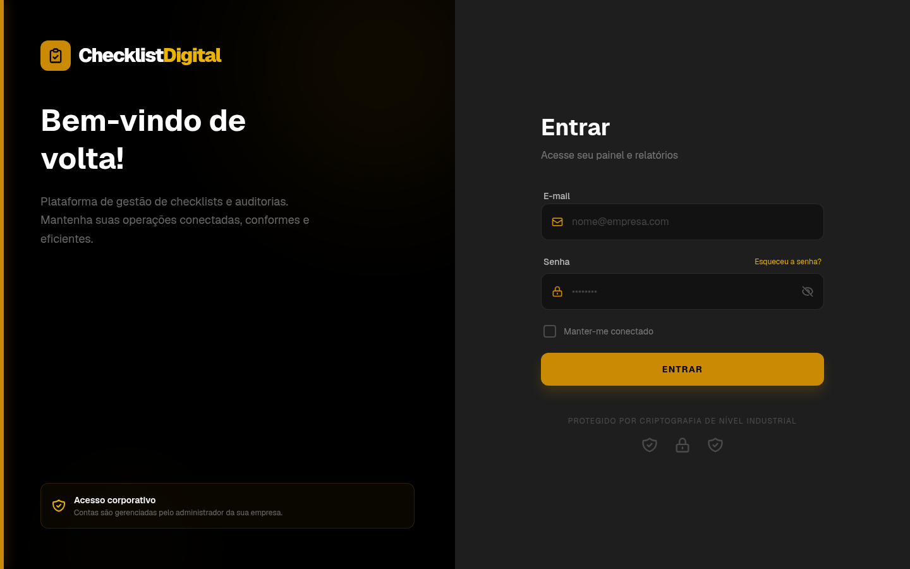

# ✅ Checklist Digital

Plataforma web para **gestão de checklists e auditorias operacionais**: crie checklists a partir de modelos, atribua responsáveis, acompanhe planos de ação e gere relatórios por setor.

🔗 **Demo:** https://checklist-digital-n6g9.vercel.app



## Funcionalidades

- **Dashboard** com contadores por status (em andamento, reaberto, em análise, reprovado, concluído)
- **Checklists**: criação a partir de modelo, com prazo, responsável, prioridade e anexos; marcação de itens concluídos
- **Checklists aplicados** e **atribuição de responsável**
- **Planos de ação** com acompanhamento de status (atrasado, aguardando solução, em análise, concluído)
- **Relatórios** por período (semana, mês, trimestre) com KPIs, ranking de colaboradores e **exportação CSV**
- **Análise automática** dos relatórios e **sugestão de itens de checklist por setor**
- **Usuários e perfis** por cargo (auditor júnior → gerente) e setor (Finanças, Operações, Qualidade, RH, TI)
- **Upload de arquivos** (até 10 MB)

## Stack

| Camada | Tecnologia |
|---|---|
| Front-end | Next.js 16 (App Router), React 19, TypeScript |
| Estilo | Tailwind CSS 4 — tema escuro com detalhes em dourado |
| Back-end | Route Handlers do Next.js (`src/app/api`) |
| Banco | Supabase (PostgreSQL) |
| Deploy | Vercel |

## Estrutura

```
checklist-digital/src/
├── app/
│   ├── api/            # rotas REST: checklists, dashboard, relatorios, sugestoes, users, uploads…
│   ├── checklists/     # novo checklist e checklists aplicados
│   ├── planos/         # planos de ação
│   ├── relatorios/     # KPIs, ranking e exportação
│   └── login/
├── components/         # dashboard, modais de usuário e de relatório
├── lib/                # tipos, cliente Supabase, utilitários
└── server/             # store em memória usado no desenvolvimento
```

## Como rodar

```bash
git clone https://github.com/AlexandreCavalcantee/Checklist-Digital.git
cd Checklist-Digital/checklist-digital
npm install
```

Crie um `.env.local` com as chaves do seu projeto Supabase:

```env
NEXT_PUBLIC_SUPABASE_URL=...
NEXT_PUBLIC_SUPABASE_ANON_KEY=...
SUPABASE_SERVICE_ROLE_KEY=...
```

```bash
npm run dev   # http://localhost:3000
```

---

Feito por [Alexandre Cavalcante](https://github.com/AlexandreCavalcantee)
